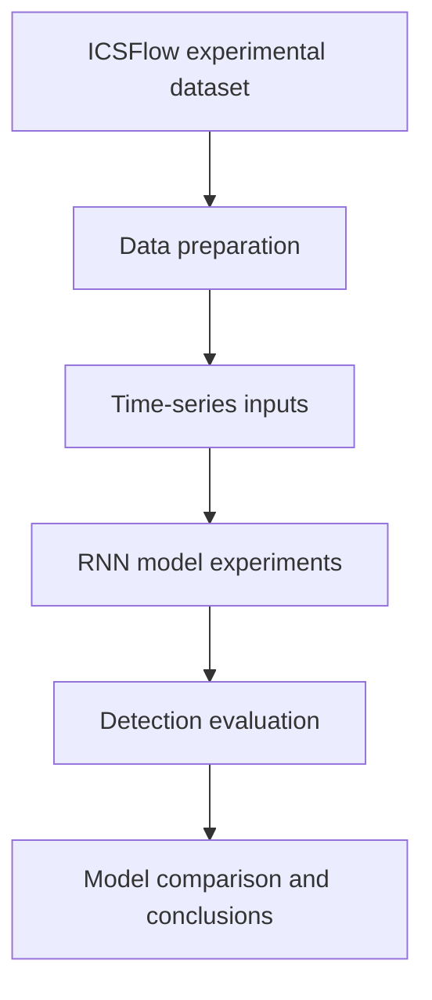

# IDS-ICS — Deep Learning for Intrusion Detection in Industrial Control Systems

**Research project | Network security | Industrial Control Systems (ICS) | Recurrent neural networks**

> **Project status:** Academic intrusion-detection research. This repository is not presented as a deployed, production-ready IDS/IPS.

## Overview

Industrial Control Systems (ICS) support physical processes, where detecting malicious network activity is especially important. This project investigates how recurrent neural network (RNN) models can distinguish attack-related network traffic in an ICS setting.

The research associated with this repository was published at **IEEE ISCC 2025**:

**Sahar Zamanian and Maria Kihl**, “An evaluation of Deep Learning-based models for Intrusion Detection in Industrial Control Systems.” [Read the publication](https://doi.org/10.1109/ISCC65549.2025.11325968).

## Research question

How do different RNN architectures compare for intrusion detection using network-flow data from an industrial control system, particularly in terms of detection accuracy and training efficiency?

## Dataset

The study uses the **ICSFlow** dataset, which is derived from a simulated **bottle-filling factory** environment. The dataset supports research into detecting attacks using industrial network traffic.

The dataset is an experimental benchmark; it is **not evidence of performance on a live industrial network**. Follow the original dataset's terms and citation requirements before downloading or redistributing it.

## Approach

The published study evaluates **five recurrent neural network models**. The research includes processing network data, preparing it for sequence-model experiments, training and evaluating architectures, and comparing their results.

*This is a conceptual summary of the research workflow, not a diagram of a deployed IDS service. For the exact preprocessing and experiment settings, consult the notebooks and publication.*

## Key finding

As reported in the publication, the **Multi-layered Bidirectional Gated Recurrent Unit (MBI-GRU)** model performed best among the evaluated models for **accuracy and training efficiency**.

Precise numerical metrics and experiment settings will be documented here after they are checked against the paper and notebook outputs. This README intentionally does not invent accuracy, F1-score, or false-positive-rate values.

## Repository contents

This repository contains research code and notebooks used to explore deep-learning approaches to ICS intrusion detection. Browse the files to see the available model experiments and analyses.

**Note:** The published paper discusses five models; this README does not assume that every paper experiment or artifact has been included in the public repository.

## Reproducibility status

The repository is being documented for easier independent reproduction. Before offering a verified quick-start command, the following details need to be checked against the existing notebooks:

- Python and library versions
- Dataset download instructions and expected local path
- Notebook execution order
- Preprocessing and train/test split settings
- Exact commands to reproduce saved evaluation results

Until those details are verified, **a clean, one-command reproduction is not claimed**.

## Research scope and operational limitations

This work provides **experimental evidence** about model-based detection using benchmark ICS traffic. Benchmark results alone do not establish production readiness.

A real-world deployment would additionally require validation of:

- Live traffic ingestion and compatibility with the model's training features
- Alert thresholds, false-positive handling, and analyst workflows
- Monitoring, logging, and resilience to service failures
- Secure deployment, access control, and operational maintenance
- Performance under realistic traffic, drift, and site-specific conditions

These are potential **future engineering extensions**, not completed features of this repository.

## Engineering roadmap

- [ ] Verify and document environment setup and dependency versions
- [ ] Document the exact dataset acquisition and notebook execution procedure
- [ ] Add verified evaluation tables and selected figures from the original experiments
- [ ] Add reproducibility checks or automated tests where practical
- [ ] Explore a separate containerized inference demonstration in an isolated lab
- [ ] Measure inference latency and monitor lab deployment health

## Publication and attribution

Zamanian, S., & Kihl, M. (2025). *An evaluation of Deep Learning-based models for Intrusion Detection in Industrial Control Systems*. 30th IEEE Symposium on Computers and Communications (ISCC 2025). https://doi.org/10.1109/ISCC65549.2025.11325968

The published study and dataset creators should be acknowledged when reproducing or adapting the experiments. Only publish data, code, images, and model artifacts that you have permission to share.
